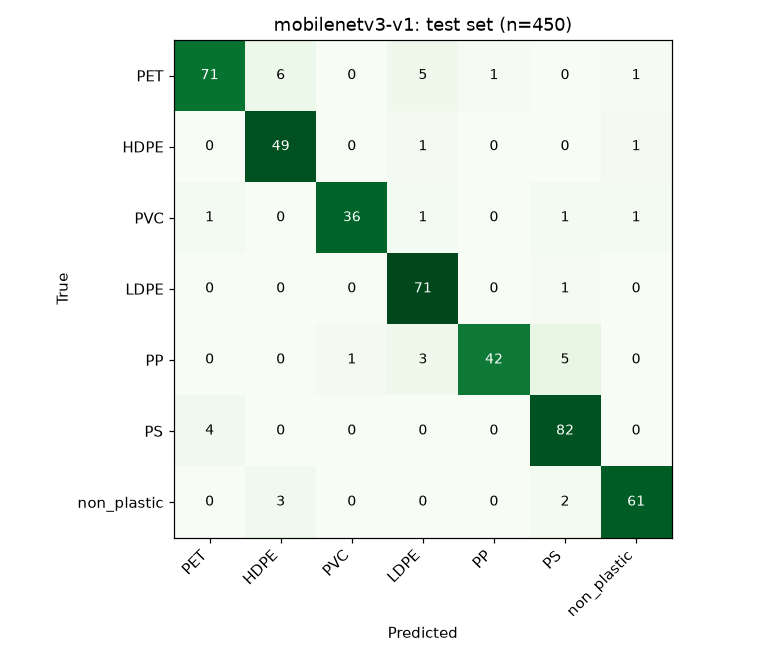

# PlasticLens model card

## 1. Dataset

### Sources

| Source | Use | Licence | Citation |
| --- | --- | --- | --- |
| PlasticWaste-DB v1 (Mendeley Data `tvfx5dspf3`) | Six polymer classes (PET, HDPE, PVC, LDPE, PP, PS) | CC BY 4.0 | Sarkar, S. C., Bushra, J. J., Hossain, M. S. *PlasticWaste-DB*, Mendeley Data, v1, doi:10.17632/tvfx5dspf3.1 |
| TrashNet (`garythung/trashnet`, `dataset-resized`) | `non_plastic` class (glass, paper, cardboard, metal) | MIT | Thung, G., Yang, M. *Classification of Trash for Recyclability Status*, 2016 |

Changes made to the data, as required by CC BY 4.0: objects were cropped from the
photos using the published bounding boxes, images were resized, and
near-duplicates were removed. The app's About screen credits both datasets.

### Raw data inspection (`preprocessing/inspect_data.py`)

| Class | Images | Corrupt | Missing label | Boxes per image | Median size |
| --- | ---: | ---: | ---: | --- | --- |
| PET | 499 | 0 | 0 | 1: 446, 2: 39, 3: 8, 4: 6 | 4000×3000 |
| HDPE | 321 | 0 | 0 | 1: 300, 2: 16, 3: 3, 4: 2 | 524×683 |
| PVC | 168 | 0 | 0 | 1: 118, 2: 20, 3: 16, 4–7: 14 | 3614×3000 |
| LDPE | 440 | 0 | 0 | 1: 403, 2: 24, 3: 9, 4+: 4 | 524×640 |
| PP | 327 | 0 | 0 | 1: 315, 2: 10, 3: 2 | 3264×3000 |
| PS | 472 | 0 | 0 | 1: 385, 2: 64, 3: 20, 4: 3 | 640×640 |
| TrashNet glass / paper / cardboard / metal | 501 / 594 / 403 / 410 | 0 | – | – | 512×384 |

The PlasticWaste-DB description states 500 PET and 322 HDPE images; the
downloaded v1 files contain 499 and 321. Labels are YOLOv8 *oriented*
bounding boxes (four corner points, exported from Roboflow).

Observations (see `figures/raw_samples.png`):

- Many PP, PS and LDPE photos show a small item lying in soil, grass or
  rubble, which makes cropping by bounding box essential.
- Several PVC images are product photos or 3-D renders on plain
  backgrounds rather than real waste photos. This is a domain gap: the
  model may learn "studio background → PVC".
- The labels come from the dataset authors; they could not be checked
  against printed resin codes.

### Processing (`preprocessing/prepare.py`)

1. Each labelled object is cropped to the axis-aligned rectangle around
   its oriented box, plus a 10 % margin. Images with several boxes produce
   several crops, all in the same group. Boxes smaller than 48 px were
   skipped (38 boxes).
2. `non_plastic`: 110 random images (seed 42) from each of TrashNet's
   glass, paper, cardboard and metal = 440 images.
3. Everything is resized so the longest side is 384 px.
4. Perceptual hashes (pHash, 64-bit) are used to:
   - drop near-duplicates (Hamming distance ≤ 4) within a class (32 removed);
   - drop conflicting near-duplicates with different labels (0 found);
   - group images at distance ≤ 10, together with crops of the same photo,
     so that a group never crosses splits.

### Split (`preprocessing/split.py`)

Grouped, stratified split: `StratifiedGroupKFold` with 20 folds (seed 42).
3 folds go to test, 3 to validation and 14 to train.

| Class | Train | Val | Test | Total |
| --- | ---: | ---: | ---: | ---: |
| PET | 396 | 84 | 84 | 564 |
| HDPE | 242 | 51 | 51 | 344 |
| PVC | 173 | 36 | 40 | 249 |
| LDPE | 339 | 72 | 72 | 483 |
| PP | 236 | 51 | 51 | 338 |
| PS | 403 | 87 | 86 | 576 |
| non_plastic | 308 | 66 | 66 | 440 |
| **All** | **2097** | **447** | **450** | **2994** |

2,994 images in 2,585 groups. Automatic checks passed: every image
opens, every image has exactly one label, no group crosses splits, and no
near-duplicate (pHash distance ≤ 4) appears in two splits.

To regenerate everything:

```powershell
C:\src\venvs\plasticlens\Scripts\Activate.ps1
cd ai_model\preprocessing
python download.py; python inspect_data.py; python prepare.py; python split.py
```

## 2. Model

| | |
| --- | --- |
| Version | `mobilenetv3-v1` |
| Architecture | `timm` `mobilenetv3_large_100`, ImageNet-pretrained, new 7-class head |
| Classes (output order) | PET, HDPE, PVC, LDPE, PP, PS, non_plastic |
| Input | 1×3×224×224 RGB, EXIF-rotated, bilinear resize to 224×224 (no crop), ImageNet mean/std |
| Output | Calibrated probabilities (temperature scaling and softmax are inside the ONNX graph) |
| Size | 17.0 MB PyTorch checkpoint, 16.8 MB ONNX |
| Intended use | Suggest the likely resin type of one household plastic item in a photo, to support sorting and learning. Not a laboratory test. |
| Out of scope | Resin code 7 and mixed or multi-layer plastics, several items in one photo, industrial waste streams |

### Training (`training/train.py`)

- Hardware: laptop CPU (12 threads), about 95 s per epoch, 27 epochs, about 45 minutes in total.
- Stage 1: head only (`conv_head` + classifier), 4 epochs, AdamW, one-cycle schedule, max LR 1e-3.
- Stage 2: whole network, max LR 3e-4, weight decay 1e-4, early stopping on validation macro-F1 (patience 7).
- Loss: cross-entropy weighted by inverse class frequency (PVC weight 1.73, PS 0.74).
- Augmentation (train only): random resized crop (scale 0.55–1), horizontal flip, ±15° rotation, colour jitter, 3 % greyscale.
- Best epoch: **20** (validation accuracy 0.888, macro-F1 0.884).

## 3. Evaluation (`evaluation/evaluate.py`)

The test set (450 images) was not used for training, checkpoint selection,
calibration or threshold selection. See the transparency note below about the
threshold targets.

| Metric | Test |
| --- | ---: |
| Accuracy | **0.916** |
| Macro F1 | **0.915** |
| Polymer-only accuracy (true class is a polymer) | 0.914 |
| ECE before → after temperature scaling | 0.052 → **0.034** |
| Plastic detected when the item is plastic | 0.992 |
| Non-plastic recall / precision | 0.924 / 0.953 |

| Class | Precision | Recall | F1 | Support |
| --- | ---: | ---: | ---: | ---: |
| PET | 0.934 | 0.845 | 0.887 | 84 |
| HDPE | 0.845 | 0.961 | 0.899 | 51 |
| PVC | 0.973 | 0.900 | 0.935 | 40 |
| LDPE | 0.877 | 0.986 | 0.928 | 72 |
| PP | 0.977 | 0.824 | 0.894 | 51 |
| PS | 0.901 | 0.953 | 0.927 | 86 |
| non_plastic | 0.953 | 0.924 | 0.938 | 66 |



Main confusions: PET → HDPE (6) and PET → LDPE (5), mostly crumpled clear
bottles and films; PP → PS (5) and PP → LDPE (3), small white or translucent
fragments in litter scenes; PS → PET (4).

### Calibration and thresholds

- Temperature **T = 2.733**, fitted on the validation set (NLL). Validation ECE 0.085 → 0.048.
- Thresholds, chosen on the validation set, applied to the top probability when it is a polymer:
  - **High ≥ 0.70**: the lowest threshold whose validation predictions are ≥ 95 % accurate.
  - **Medium 0.30–0.70**: shown as "Please verify".
  - **Low < 0.30**: shown as "Unable to identify reliably".
  - If `non_plastic` is the top class, the app shows "No plastic detected".
- How the policy behaves on the test set:

| Bucket | Share of test images | Accuracy |
| --- | ---: | ---: |
| High | 74.0 % | **97.3 %** |
| Medium (please verify) | 10.7 % | 54.2 % |
| Low (unable to identify) | 1.1 % | 20.0 % |
| Non-plastic | 14.2 % | 95.3 % |

Transparency note: the first evaluation run used targets of 90 % / 75 %.
These gave a "High" cut-off of only 0.36, which reads badly on a result
card ("Likely PET, 36 %"). The targets were raised to 95 % / 85 % and the
thresholds re-picked **on the validation set only**. Accuracy, F1 and ECE
are unaffected, because thresholds do not change the predicted class; only the
policy table above was re-scored.

## 4. Deployment checks

| Check | Result |
| --- | --- |
| PyTorch vs ONNX, 100 test images (`export/verify_onnx.py`) | max abs diff 4.0e-6, 0 top-1 mismatches |
| Dart preprocessing vs Python (`test/preprocess_parity_test.dart`) | channel means within 0.015 std, pixels within ~4 grey levels (Pillow's resampling ported to Dart) |
| On-device ONNX, airplane mode, emulator (`integration_test/classifier_parity_test.dart`) | 7/7 same top-1 as Python, probabilities within 0.05 |
| Latency, Pixel 7 emulator on a laptop, preprocess + inference | median ~115 ms (first scan ~600 ms including model load) |
| Latency, physical phone | *to be measured (PLAN Section 4)* |

## 5. Limitations and risks

- **Not a chemical test.** Different plastics can look identical, so the app always asks users to check the printed resin code.
- **Dataset domain.** The plastic photos come from a single dataset (PlasticWaste-DB), and many show litter on soil. Clean household items photographed indoors are under-represented. Some PVC images are product renders.
- **Labels** come from the dataset authors and could not be checked against resin codes.
- **Non-plastic coverage** is limited to glass, paper, cardboard and metal (TrashNet). Wood, fabric, food and similar items may be misread.
- **One item per photo.** There is no object detector, so cluttered scenes reduce accuracy.
- Misuse risk is low. The main harm would be wrong recycling advice, which the uncertainty states and the "check your local scheme" note are there to reduce.

## 6. Image test scenarios (identification spec §15.2)

`evaluation/scenarios.py` runs the shipped ONNX model and threshold policy
on the 450 held-out test images, either transformed or as a selected subset.
"Unsure" means the app shows *Please verify* or *Unable to identify
reliably*. "Confident and wrong" is the harmful case: High (or No plastic)
with the wrong class.

| Scenario | n | Accuracy | Shown as unsure | Confident and wrong |
| --- | ---: | ---: | ---: | ---: |
| Baseline (test set as-is) | 450 | 91.6 % | 11.8 % | 2.7 % |
| Low light (35 % brightness) | 450 | 86.2 % | 22.2 % | 4.9 % |
| Very low light (15 %) | 450 | 62.9 % | 48.2 % | 10.0 % |
| Blurred (Gaussian r = 3) | 450 | 75.1 % | 34.0 % | 5.3 % |
| Motion-like blur (box r = 6) | 450 | 70.9 % | 41.8 % | 6.2 % |
| Heavy JPEG (quality 10) | 450 | 79.1 % | 26.2 % | 6.0 % |
| Rotated 90° | 450 | 89.1 % | 15.1 % | 5.8 % |
| Overexposed (180 %) | 450 | 81.6 % | 23.8 % | 4.9 % |
| Greyscale | 450 | 87.6 % | 21.6 % | 3.3 % |
| Dark plastics (mean brightness < 0.30) | 8 | 62.5 % | 37.5 % | 0.0 % |
| PET (mostly transparent bottles) | 84 | 84.5 % | 20.2 % | 7.1 % |
| Non-plastic objects | 66 | 92.4 % | 6.1 % | 1.5 % |
| Multiple objects (whole photo, 2+ items) | 41 | 70.7 % | 19.5 % | **17.1 %** |

Findings:

- Image quality problems mostly push results into the *unsure* states instead
  of producing confident errors. Even at 15 % brightness only 10 % of results
  are confidently wrong.
- **Several items in one photo is the weakest case** (17 % confidently wrong).
  The scanner asks users to "Fill the frame with one item". An object detector
  (identification spec §5, optional YOLOv8n) would be the next improvement.
- Transparent PET is harder than the average class (84.5 %), as identification spec §19 predicted.
- The dark-plastics subset is too small (8 images) to draw conclusions from.
  It should be re-tested with real photos.
- Crushed objects, plastic bags and unseen backgrounds are covered only by
  whatever the dataset already contains. They need real photos taken with the
  app (PLAN Section 11).
